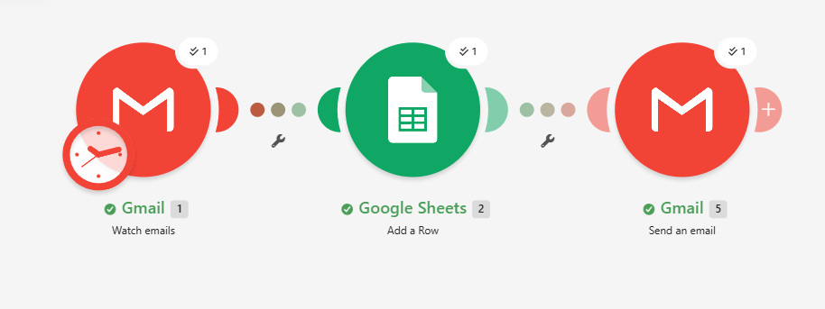
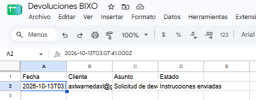
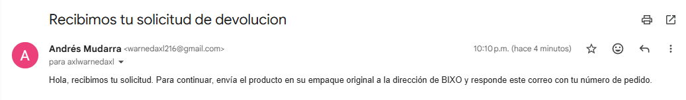

# Lab 3: primer flujo no-code funcional

## Flujo: Registro automático de solicitudes de devolución de BIXO

**Herramienta:** Make

**Por qué este flujo:** en el Checkpoint 1 elegí automatizar el primer tramo de la devolución de pedidos de BIXO: recibir la solicitud y mandarle las instrucciones al cliente sin hacerlo a mano. Este lab es una versión pequeña de esa idea para practicar con una herramienta no-code.

**Disparador (Trigger):**
- Aplicación: Gmail
- Evento: "Watch Emails" (llega un correo nuevo)
- Filtro: tipo "Gmail filter" con la búsqueda `subject:"Solicitud de devolución"`, para que solo se active con correos que tengan ese asunto

**Pasos del flujo:**
1. ACCIÓN: Google Sheets → Add a Row (hoja "Devoluciones BIXO")
   - Columna "Fecha": fecha en que llegó el correo
   - Columna "Cliente": correo del remitente
   - Columna "Asunto": asunto del correo
   - Columna "Estado": "Instrucciones enviadas" (texto fijo)
2. ACCIÓN: Gmail → Send an Email
   - Para: el correo del remitente de la solicitud
   - Asunto: "Recibimos tu solicitud de devolucion"
   - Mensaje: un texto corto con las instrucciones para devolver el producto

**Lógica del flujo:** cuando alguien manda un correo con ese asunto, Make lo detecta, lo guarda como una fila en una hoja de cálculo (así queda un registro de todas las solicitudes) y le responde al cliente con las instrucciones. Antes, alguien tenía que leer el correo, anotarlo y contestar a mano. Aquí todo pasa en segundos y sin intervención.

**Cómo lo probé:** desde otra cuenta de correo mandé un mensaje con el asunto "Solicitud de devolución" a la cuenta conectada a Make. El flujo corrió una vez, los tres módulos se ejecutaron bien, se agregó la fila en la hoja y la otra cuenta recibió la respuesta con las instrucciones.

**Capturas de pantalla:**

El flujo configurado en Make, con los tres módulos ejecutados:

La fila que se creó en Google Sheets:

El correo de respuesta que recibió el cliente:

**Declaración de uso de IA:**

Para este laboratorio usé dos herramientas de IA. Gemini lo usé para conocer mejor la plataforma que iba a usar (Make) y entender cómo funciona. Con Claude me guié paso a paso para armar el flujo y me ayudó a organizar todo el trabajo, desde la idea del flujo basada en mi Checkpoint 1 hasta este README. El flujo lo armé y lo probé yo en mi cuenta de Make, y las capturas son de esa prueba. Revisé el texto antes de entregarlo y me hago responsable de lo que entrego.
